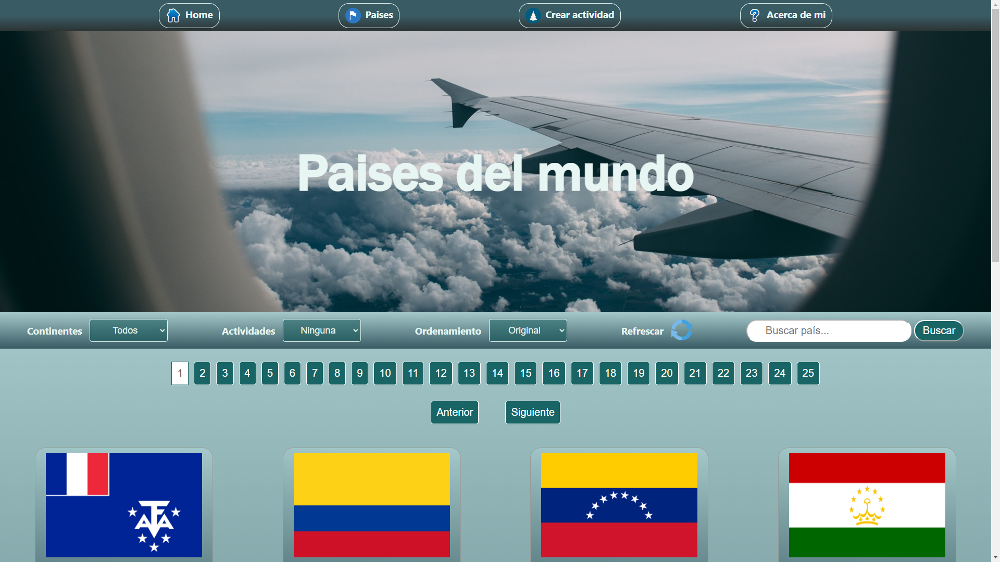

  🌐 <b>English</b> · <a href="README.es.md">Español</a>

<h1 align="center">Hi 👋, I'm Lautaro Lesniewicz</h1>
<h3 align="center">Full Stack Engineer · Backend-Focused · Java Spring Boot · Node.js / NestJS · React</h3>

  📍 Buenos Aires, Argentina (GMT-3) · 🌎 Available for remote work worldwide · 🗣️ English C2 · Spanish (native)

  
  
  

---

## 🚀 About Me

I'm a **Full Stack Engineer with 3+ years of commercial experience** shipping production systems used by **hundreds to tens of thousands of users**, for government, industrial and e-commerce clients in **Argentina 🇦🇷, Chile 🇨🇱 and New Zealand 🇳🇿**.

I work across the whole stack, from **Java Spring Boot and Node.js APIs** to **React and Angular** front ends. I've **led small dev teams**, owned projects end to end, and built **high-concurrency systems that handle traffic spikes of 10–15x normal load** on public platforms.

I care about clean architecture, maintainable code and systems that stay reliable as they grow. I'm comfortable working async with distributed teams, and my time zone overlaps with **US business hours**.

### ⚡ Quick facts for recruiters

| | |
|---|---|
| 💼 **Experience** | 3+ years in production · Team lead for 1–2 developers |
| 🌍 **Markets** | Argentina · Chile · New Zealand · open to all countries |
| 🕒 **Time zone** | GMT-3, overlaps with US Eastern / Central / Pacific business hours |
| 🗣️ **Languages** | English C2 (EF SET) · Spanish native · Portuguese A1 |
| 🤝 **Engagement** | Full-time or contract (B2B / contractor) · Remote, hybrid or relocation |
| 🎯 **Roles** | Backend · Full Stack · Platform / system-focused engineering |

---

## 📈 Impact Highlights

- 🔥 **Kept a government platform stable at 10–15x normal traffic** (10,000–15,000 concurrent users) by designing a **Kafka-based event queue**
- ⚡ **~2x faster file uploads** after redesigning the **AWS S3 upload pipeline**
- 🗄️ **Lighter, faster queries** after redesigning **PostgreSQL schemas** for high-volume, time-sensitive transactional workflows
- 👥 **Led end-to-end delivery** of a Spring Boot + Angular platform with 1,000+ daily users while contributing to 2 other live projects
- 🏭 **Built several full-stack apps from scratch** that automated critical workflows in the **mining sector** (100–500 active users)
- 🛒 **Delivered an e-commerce food store with payments and admin dashboards** for a New Zealand client

---

## 🛠 Tech Stack

**Backend**

**Databases & Cloud**

**Frontend**

**Practices & Tools**

Git · GitHub · REST API design · Event-driven architecture · Unit & integration testing · CI/CD · Cloud deployment · Agile / Scrum · Code reviews · Figma · AI-assisted development (Claude, MCP)

---

## 🏗 Professional Experience

### Full Stack Developer, **Phinx Lab** · Buenos Aires, Argentina
*Dec 2023 – Present · Software consultancy building digital platforms for the public sector*

- Led **end-to-end delivery** of a government platform (**Java Spring Boot + Angular**) with **1,000+ daily users** and peaks of **10,000–15,000 concurrent users**, managing 1–2 developers while contributing to 2 other production projects
- Designed a **Kafka-based event queue** that absorbs traffic spikes during large civic events and keeps the platform stable at **10–15x normal load**
- Built an **AWS S3 file upload pipeline** that made uploads **~2x faster**, a big UX improvement across the platform
- Designed and optimised **PostgreSQL schemas** for high-volume transactional workflows, cutting query overhead in time-sensitive government operations
- Ran agile delivery across several projects at once: requirements, sprint planning and production releases

### Full Stack Developer, **IT Procesos** · Santiago, Chile
*Apr 2023 – Dec 2023 · Software consultancy · Contract ended when the project closed*

- Designed and built **several full-stack apps from scratch** that automated critical workflows for **mining operations**, reaching **100–500 active users** in production
- Built **RESTful APIs** and managed relational databases (**MySQL, PostgreSQL**) with **Prisma**, protecting data integrity in high-stakes industrial use cases
- Turned **Figma** designs into reusable, production-ready **React + Redux Toolkit** component libraries
- Deployed to cloud environments using Git and Scrum for the whole project lifecycle

---

## 💼 Featured Projects

### 🍯 Manuka Brothers: E-commerce Food Store · *Client project, New Zealand 🇳🇿*
A new online food store built for a New Zealand business, from product catalogue to checkout.
- Customer-facing storefront with product catalogue, cart and **online payments**
- **Admin dashboards** for tracking payments and orders and managing the store
- Built end to end for a real client: requirements, implementation and deployment

### 📦 S3 Bulk Document Downloader · *Production tool for a public-sector enrolment platform*

`Java` `Quarkus` `Hibernate / Panache` `Oracle` `AWS S3` `JUnit / REST Assured`
- REST service that **streams files from S3 straight into a ZIP download**, so admins can fetch every document for an enrolment or site in one request
- Streaming design (`StreamingOutput` + `ZipOutputStream`) keeps **memory use constant** no matter how many files are in the archive
- Clean layered architecture (resource → facade → service → repository) with unit and integration tests

### 😇 Heaven & Hell: Product Catalogue + Admin CMS
 

`NestJS` `TypeORM` `PostgreSQL` `JWT / Passport` `AWS S3` `React` `TypeScript` `Redux Toolkit` `MUI`
- Full-stack catalogue site with a **protected admin dashboard** for products, categories and news
- **JWT authentication** with route guards, plus **image uploads to AWS S3**

### ⏱️ Timesheet & Project Hours Tracker

`NestJS` `Prisma` `JWT` `Next.js` `MUI DataGrid` `Recharts` `ExcelJS`
- Internal tool for logging hours across **companies, customers, projects and positions**
- Responsive data grids with filters, **Excel/CSV exports** and dashboard charts

### 🤝 Changuitas: Freelance Jobs Marketplace · *7-person team project*

`Node.js` `Express` `Sequelize` `PostgreSQL` `JWT` `React` `Redux` `MUI`
- Marketplace that connects clients with local workers, with profiles, contracts, ratings and chat
- Built with feature branches, code reviews and Scrum sprints

### 🌍 Countries of the World
 

`React` `Redux` `Express` `Sequelize` `PostgreSQL`
- SPA with search, filtering by continent and activity, sorting, pagination and a form to create tourist activities

  

**Also on my GitHub:** a production-ready [NestJS + Prisma backend template](https://github.com/LautaroLesni/nestjs-prisma-template), a [Vite + React + Redux Persist starter](https://github.com/LautaroLesni/vite-react-redux-persist-template), a full-stack [NestJS + React notes app](https://github.com/LautaroLesni/notes-app-nestjs-react) built for a technical assessment, and a [landing page for an AI services client](https://neural-rays-ai-services.vercel.app).

---

## 🤖 AI-Assisted Engineering

I use AI tools like **Claude** to speed up repetitive work, review architecture decisions and refine logic, while staying fully responsible for correctness, security and edge cases. I've also **built custom Claude skills and connected them to MCP servers** to automate multi-step workflows.

> AI speeds up my workflow, but engineering judgement drives every decision.

---

## 🎓 Education

- **Associate Degree in Programming**, Universidad Tecnológica Nacional (UTN) San Nicolás · *In progress*. One of Argentina's leading technical universities
- **Full Stack Development Bootcamp**, Henry · 2023 · 800+ hours of intensive full-stack training
- **Object-Oriented Programming (C# / .NET)**, Universidad Nacional Arturo Jauretche · 2023

---

## 📌 Current Focus

- System design and distributed, event-driven architectures
- Database performance and scalability
- Building products for **international teams**, remote or on-site

---

## 📫 Let's Talk

📧 **lautarolesniewicz@gmail.com**
📱 **+54 9 11 5754-8304**
🔗 [linkedin.com/in/lautarolesniewicz](https://www.linkedin.com/in/lautarolesniewicz)
🌐 [lautarolesniewicz.com](https://www.lautarolesniewicz.com)

> ✅ **Open to backend, full-stack and platform roles worldwide**: remote, hybrid in Buenos Aires, or relocation. Full-time or contract.
